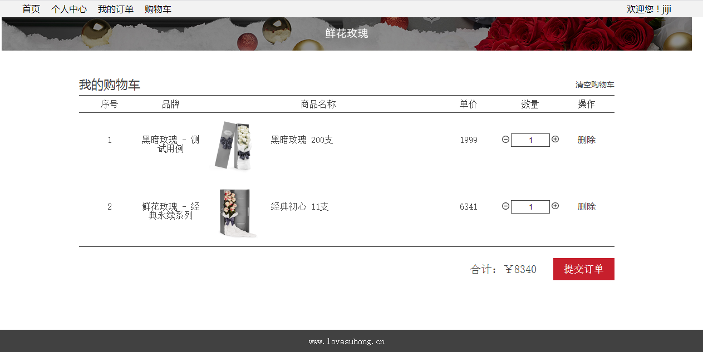
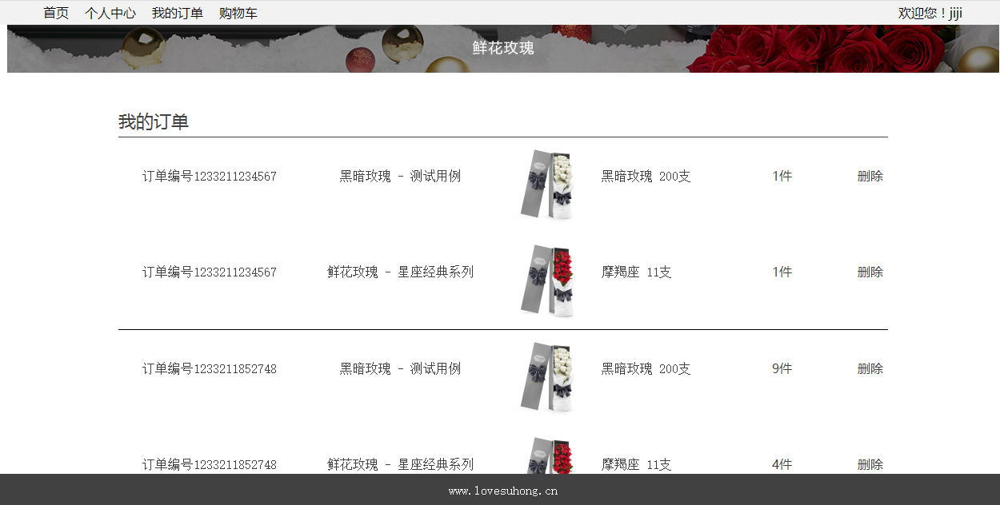
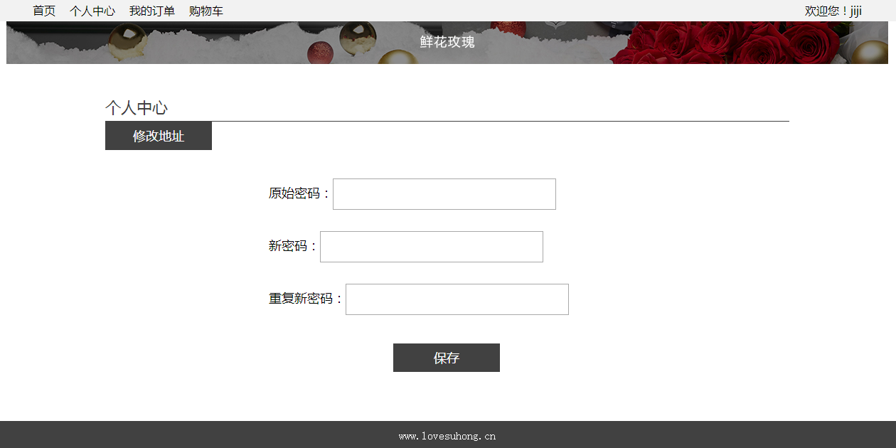

# 🌹 Java Rose Shop - 玫瑰商城

一个基于Java、Spring、SpringMVC、Mybatis、MySQL的在线商城系统。

## ✨ 功能特性

* 🔐 用户登录、注册
* 🛍️ 浏览所有商品
* 📝 商品详情查看
* 🛒 购物车管理
* 📦 订单管理
* 👤 个人信息管理

## 🏗️ 技术栈

- **后端**: Java, Spring, SpringMVC, MyBatis
- **数据库**: MySQL
- **前端**: HTML, CSS, JavaScript, jQuery
- **构建工具**: Maven

## 📸 项目截图

### 登录页面


### 首页


### 商品列表


### 购物车


### 订单管理


### 用户中心


## 🚀 快速开始

### 环境要求
- JDK 1.8+
- MySQL 5.7+
- Maven 3.6+
- Tomcat 8.5+

### 安装步骤

1. **克隆项目**
   ```bash
   git clone https://github.com/your-username/java-rose-shop.git
   cd java-rose-shop
   ```

2. **导入数据库**
   ```bash
   mysql -u root -p < crm.sql
   ```

3. **配置数据库连接**
   
   修改 `src/dbconfig.properties` 文件中的数据库配置：
   ```properties
   jdbc.driver=com.mysql.jdbc.Driver
   jdbc.url=jdbc:mysql://localhost:3306/your_database_name
   jdbc.username=your_username
   jdbc.password=your_password
   ```

4. **构建并部署**
   ```bash
   mvn clean package
   # 将生成的 war 包部署到 Tomcat
   ```

5. **访问应用**
   
   打开浏览器访问：`http://localhost:8080/crmtask`

## 📁 项目结构

```
java-rose-shop/
├── src/                    # 源码目录
│   ├── org/crm/           # 主要业务代码
│   ├── easy/util/         # 工具类
│   ├── mybatis/           # MyBatis配置
│   └── spring/            # Spring配置
├── WebContent/            # Web资源
│   ├── css/               # 样式文件
│   ├── js/                # JavaScript文件
│   ├── img/               # 图片资源
│   └── *.html             # 页面文件
├── readmeImg/             # README图片
└── crm.sql               # 数据库脚本
```

## 🤝 贡献指南

1. Fork 本仓库
2. 创建您的特性分支 (`git checkout -b feature/AmazingFeature`)
3. 提交您的更改 (`git commit -m 'Add some AmazingFeature'`)
4. 推送到分支 (`git push origin feature/AmazingFeature`)
5. 打开一个 Pull Request

## 📄 许可证

本项目基于 MIT 许可证开源 - 查看 [LICENSE](LICENSE) 文件了解详情。

## ☕ 支持作者

如果这个项目对您有帮助，请考虑给作者买杯咖啡 ☕

### 微信打赏


### 支付宝打赏


---

⭐ **如果您觉得这个项目不错，请给个 Star 支持一下！** ⭐

## 📞 联系方式

- 📧 Email: 823987653@qq.com
- 🐛 Issues: [提交问题](https://github.com/your-username/java-rose-shop/issues)

---

<p align="center">
  <b>感谢您的关注和支持！</b><br>
  Made with ❤️ by Rshan
</p>